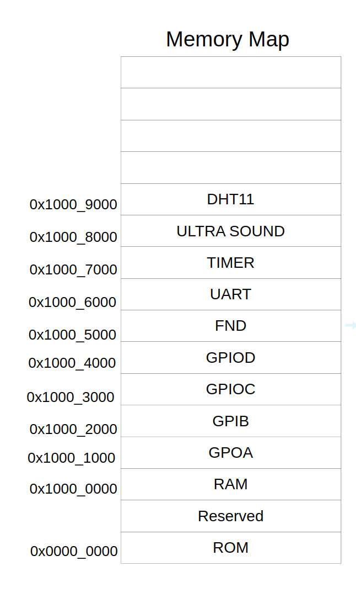

# RISC-V CPU & APB Peripheral System

Harman Semicon Academy | April–May 2025  
SystemVerilog / Verilog / C

This project started with connecting a RISC-V RV32I CPU to an AMBA APB bus. I built up the system step by step, from APB read/write transfers to memory-mapped peripherals controlled by C code running on the CPU.

The CPU RTL was developed as part of the [HARMAN_CPU](https://github.com/goeun-oh/HARMAN_CPU) project. This repository focuses on the bus, peripherals, integration, and simulation work.

## System overview

```text
                  Instruction ROM
                         |
                    RV32I CPU
                         |
                    APB Master
                         |
                 Address Decoder
                         |
       +-----------------+------------------+
       |          |      |       |          |
      RAM       GPIO   Timer   UART/FIFO   Sensors
                       / FND              (US, DHT11)
```

The APB master handles the `IDLE -> SETUP -> ACCESS` transfer sequence, latches the address/write data, and selects a peripheral based on the address. The CPU's memory-access stage waits for the bus `ready` response before moving on.

## What I worked on

- **APB bus:** Implemented the master, address decoder, read-data mux, and memory-mapped read/write interface.
- **Peripheral integration:** Connected RAM, GPI/GPO/GPIO, a seven-segment display, timer, UART with FIFO, and sensor interfaces.
- **CPU-controlled software:** Used C applications and memory-mapped registers to control peripherals.
- **Verification:** Wrote SystemVerilog tests for APB-connected blocks, including class-based generator/driver/monitor/scoreboard testbenches for FND and UART/FIFO.

The final system includes both my integration/application version and a team-merged version.

## Repository structure

| Folder | Contents |
| --- | --- |
| [`APB_v00_APB만들기/`](APB_v00_APB만들기/) | APB master, slave, address decoder, and transfer timing |
| [`APB_v01_Peri붙이기(RAM,GPO,GPI)/`](APB_v01_Peri붙이기%28RAM%2CGPO%2CGPI%29/) | CPU connection and initial RAM, GPO, GPI peripherals |
| [`APB_v02_GPIO/`](APB_v02_GPIO/) | GPIO design and register control |
| [`APB_v03_fndIP_systemverilog/`](APB_v03_fndIP_systemverilog/) | Seven-segment display IP and SystemVerilog verification |
| [`APB_v05_timer/`](APB_v05_timer/) | Timer design, prescaler, and register notes |
| [`APB_final/`](APB_final/) | FIFO/UART development and integrated system |

In `APB_final/`:
- [`4.addapp/`](APB_final/4.addapp/) — my final RTL/application integration work
- [`5.merge/`](APB_final/5.merge/) — team-merged system
- [`3.uart_fifo/uart_fifo_tb/`](APB_final/3.uart_fifo/uart_fifo_tb/) — UART/FIFO SystemVerilog testbenches

## Memory-mapped peripherals

The peripherals are selected by address, and C code accesses their control/data registers through pointers or register structures.



For example, GPO and GPI use separate base addresses, while the timer provides control and counter registers. The final integration also maps UART, FND, ultrasonic sensor, and DHT11 interfaces into the APB address space.

## A debugging note: UART FIFO

One issue I ran into was data loss when writing several UART bytes back-to-back. The CPU could enqueue data faster than the serial transmitter could send it, so writes needed proper pacing or FIFO-status checks.

I first worked around it with delays in the C application and documented why polling the FIFO-full status before writing would be a better approach. The analysis and code are in [`APB_final/readme.md`](APB_final/readme.md).

## Verification notes

The repository contains directed APB tests and class-based SystemVerilog environments using transactions, mailboxes, drivers, monitors, and scoreboards. The FND tests compare the displayed output with a reference value; the UART/FIFO tests include serial data sampling and comparisons.

These are learning-project testbenches, not a packaged UVM regression or a complete CPU ISA compliance suite.
